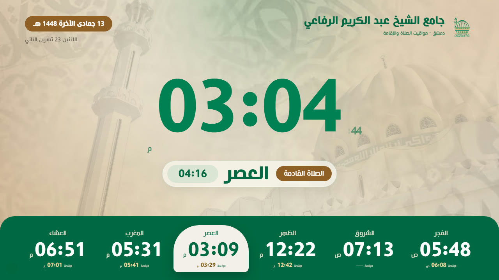
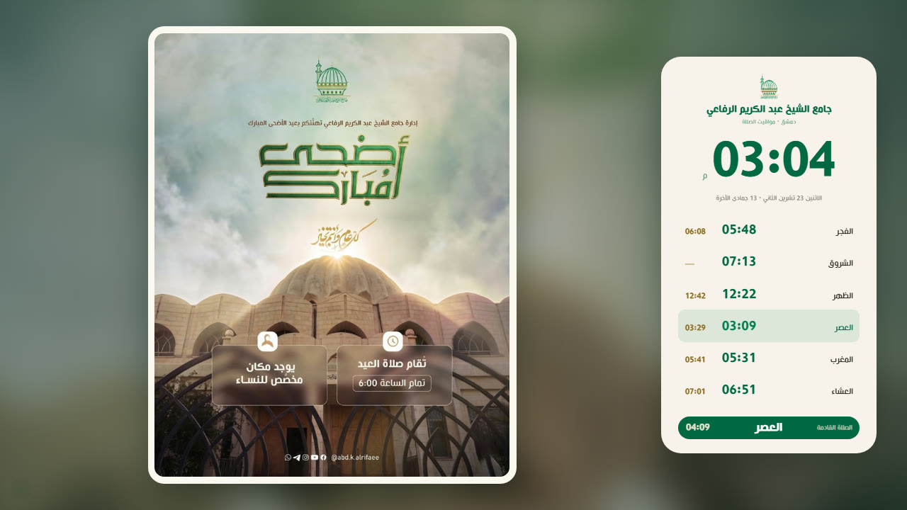

# مواقيت الصلاة · جامع الشيخ عبد الكريم الرفاعي

شاشة عرض مواقيت الصلاة والإقامة لجامع الشيخ عبد الكريم الرفاعي (دمشق)، بهوية الجامع
الجديدة: أخضر، ذهبي، كريمي، وخلفية ضباب الجامع. صفحة ثابتة واحدة تعمل بلا إنترنت وبلا
مكتبات خارجية: الخطوط والصور والمواقيت كلها محلية.




## النسخة المنشورة

**https://enderknght159.github.io/tawkit-refa3i/**

> الصور المضافة من لوحة الإعدادات تُحفظ في متصفح جهاز العرض فقط ولا تُنشر مع الموقع.
> لنشر إعلانات ثابتة على الإنترنت، أضفها إلى `assets/ads/manifest.json` وارفع التغييرات.

## ما تعرضه

- ساعة جارية بالعربية مع التاريخ الهجري والميلادي، والثواني وإشارة ص/م على جانبيها
  دون أن تزحزح مركز الساعة.
- شريط واحد للصلاة القادمة وعدّادها التنازلي، ويتحول بين الأذان والإقامة إلى «باقي للإقامة».
- جدول الصلوات الخمس مع الشروق: وقت الأذان ووقت الإقامة، والصلاة القادمة داخل قوس كريمي
  في الشريط الأخضر.
- شاشتا الأذان والإقامة بملء الشاشة مع تذكير إغلاق الجوال.
- إعدادات محفوظة في المتصفح: دقائق الإقامة لكل صلاة، نظام ٢٤ ساعة، إشارة ص/م،
  تصحيح التاريخ الهجري، وقت خطبة الجمعة.
- **إعلانات مصوّرة وفيديو** تعمل بثلاث طرق، وبطبقتين: صورة (أو فيديو) مموّهة تملأ
  الشاشة، وبطاقة أصغر تترك مساحة على يمينها لموجز الساعة وأوقات الصلاة.

## الإعلانات

### طرق العرض

| الوضع | السلوك |
| --- | --- |
| **مختلط** | الشاشة الأساسية (٣٠ ثانية افتراضياً) ← إعلان (٢٠ ثانية) ← الشاشة الأساسية ← الإعلان التالي… |
| **الشاشة الأساسية فقط** | تبقى شاشة المواقيت ظاهرة دائماً ولا تظهر الإعلانات. |
| **الإعلانات فقط** | تتناوب الإعلانات وحدها بلا ظهور الشاشة الأساسية. |

المدّتان قابلتان للتعديل من تبويب «الإعلانات». وتتوقف الإعلانات تلقائياً أثناء شاشتي
الأذان والإقامة.

> يبدأ البرنامج على وضع **الشاشة الأساسية فقط** كي لا تظهر صور تجريبية على شاشة الجامع.
> ثلاث صور نموذجية موجودة في القائمة للمعاينة؛ عند إدخال إعلاناتك اختر **مختلط** أو
> **الإعلانات فقط**، واحذف النماذج.

### إضافة الصور والفيديوهات

**من داخل الشاشة:** زر الإعدادات ← تبويب «الإعلانات» ← «أضف صور أو فيديوهات الإعلانات».
يمكن اختيار عدة ملفات أو سحبها إلى المنطقة المخصّصة. تُصغّر الصور تلقائياً إلى حد ٢٤٠٠ بكسل،
وتُحفظ داخل متصفح جهاز العرض (IndexedDB). الفيديوهات تُحفظ كما هي دون إعادة ترميز، فيُفضّل
MP4 بترميز H.264 (وحد أقصى ٣٢٠ م.ب للملف). من نفس القائمة يمكنك الترتيب بالأسهم أو الحذف.

> الصور والفيديوهات المضافة من الواجهة مرتبطة بجهاز العرض والمتصفح. مسح بيانات المتصفح
> يحذفها، لذا استعمل طريقة المجلد أدناه إن أردت محتوى ثابتاً لا يتأثر.

**من مجلد الإعلانات:** انسخ الوسائط إلى `assets/ads/` ثم اكتبها في
`assets/ads/manifest.json`:

```json
{
  "ads": [
    { "src": "assets/ads/poster-1.jpg", "title": "درس التفسير" },
    { "src": "assets/ads/poster-2.jpg", "title": "صلاة العيد" },
    { "src": "assets/ads/lesson.mp4", "title": "دعوة للدورة الصيفية", "type": "video" }
  ]
}
```

إعلانات المجلد تظهر بعد الإعلانات المضافة من الواجهة، ولا تُحذف من اللوحة. الصور
الثلاث المضمّنة الآن (`sample-*.jpg`) **نماذج للمعاينة** مأخوذة من مراجع هوية الجامع؛
احذفها من `manifest.json` عند إدخال إعلاناتك الحقيقية.

### كيف تظهر

- **الطبقة الدنيا:** الصورة (أو الفيديو) نفسها تملأ الشاشة بتمويه شديد مع تعتيم أخضر لضبط تباين النص.
- **الطبقة العليا:** الصورة واضحة داخل إطار كريمي (بطاقة مطبوعة) أصغر من الشاشة، وتنتقل بين
  الإعلانات بتلاشٍ مع تمويه وحركة خفيفة إلى الأعلى أو الأسفل.
- **على يمين البطاقة:** لوحة الموجز: شعار الجامع واسمه، الساعة، التاريخ، أوقات الأذان
  والإقامة، وشريط الصلاة القادمة مع المدة المتبقية. بين الأذان والإقامة يتحول الشريط إلى
  «باقي للإقامة» مع العدّ التنازلي للإقامة.
- الفيديوهات تعمل بصورة تلقائية ومكتومة افتراضياً (خيار «كتم صوت الفيديوهات» في تبويب
  الإعلانات). لا تُشغَّل الإعلانات فوق شاشتي الأذان والإقامة.
- في الشاشات العمودية تنتقل لوحة الموجز إلى الأعلى وتصبح البطاقة أسفلها.

## التشغيل

```powershell
node server.mjs          # المنفذ الافتراضي 8080
node server.mjs 3000     # منفذ آخر
```

ثم افتح `http://localhost:8080`.

يمكن فتح `index.html` مباشرة، لكن بعض المتصفحات تمنع تحميل الخطوط أو قراءة
`manifest.json` من نظام الملفات؛ لذا يُفضّل الخادم. للعرض الدائم على شاشة داخل الشبكة
المحلية استعمل عنوان جهاز التشغيل.

### معاملات عرض سريعة (اختيارية)

- `?view=mixed` أو `?view=main` أو `?view=ads` — يفرض وضع العرض لهذه الجلسة.
- `?main=10&ad=8` — يفرض مدة الشاشة ومدة الإعلان بالثواني (للمعاينة).
- `?preview=adhan` أو `?preview=iqama` أو `?preview=ad` — يفتح معاينة مباشرة.

مثال: `http://localhost:8080/?view=ads&ad=8`

## الملفات

| المسار | الوظيفة |
| --- | --- |
| `index.html` | الشاشة الرئيسية وشاشة الإعلان وشاشتا الأذان والإقامة ولوحة الإعدادات |
| `assets/css/brand.css` | متغيّرات الهوية (الألوان، الخطوط، المكوّنات) — من دليل الهوية |
| `assets/css/app.css` | تنسيقات الشاشة بكل المقاسات |
| `assets/js/app.js` | الساعة، المواقيت، العدّاد، تدوير الإعلانات، الإعدادات |
| `assets/js/store.js` | حفظ صور وفيديوهات الإعلانات في IndexedDB وقراءة `manifest.json` |
| `assets/js/data.js` | أوقات السنة (٣٦٦ يوماً) مضمّنة |
| `assets/fonts/` | خطّا Hacen Algeria وHD محلياً (TTF) |
| `assets/img/` | الشعارات، خلفية ضباب الجامع، وأيقونة الموقع |
| `assets/images/refa3i default bg.png` | ملف الخلفية الأصلي كما ورد من الجامع؛ المستخدم في الشاشة هو `assets/img/bg-refa3i.jpg` |
| `assets/ads/` | مجلد الإعلانات و`manifest.json` وملاحظاته |
| `docs/` | لقطتا الشاشة الأساسية وشاشة الإعلان المستخدمتان في هذا الملف |
| `server.mjs` | خادم محلي ثابت لملفات المشروع |
| `preview.html` | معاينة الشاشة بمقاسات الهاتف واللوحي والشاشة |
| `tools/shot.ps1` | لقطة شاشة سريعة عبر Chrome بلا واجهة |
| `tools/shot-cdp.mjs` | لقطة شاشة بوقت حقيقي مع إمكانية تنفيذ أوامر (للمراجعة البصرية) |

## الهوية

الألوان والخطوط والشعار من `rifaee-styleguide`:

- أخضر `#008053` / `#006843` / `#007d4e`
- ذهبي `#c9ab5f` ونحاسي `#c18b47`
- كريمي `#e8e1cf` / `#f4efe9`
- خطّان: Hacen Algeria HD للعناوين والأرقام، وHacen Algeria للنصوص.

القياسات مبنية على وحدة `--u`: تساوي ١ بكسل على شاشة 1920×1080 وتتدرّج مع المقاس،
فتعمل الشاشة على 1080p و4K واللوحي والهاتف.

## المواقيت

`assets/js/data.js` يحتوي أوقات السنة كما وردت في جدول الجامع بتوقيت دمشق. تُحسب الإقامة
بإضافة دقائق الإقامة إلى الأذان، ويُستبدل الظهر بالجمعة يوم الجمعة، مع إمكانية تحديد وقت
خطبة مستقل. التاريخ الهجري من تقويم أم القرى مع تصحيح يدوي من −٢ إلى +٢ يوم.

## ملاحظات

- شاشتا الأذان والإقامة تعملان تلقائياً: ٣ دقائق بعد الأذان و١٠ دقائق بعد الإقامة.
- الإعلانات لا تظهر فوق شاشتي الأذان والإقامة، ولا تتقدّم أثناء فتح لوحة الإعدادات.
- اختصارات: `S` للإعدادات، `F` لملء الشاشة، `Esc` لإغلاق اللوحة أو إنهاء معاينة.
- الخطّان مضافان محلياً من نسخة متاحة على الشبكة؛ إن كانت لديك نسخة مرخّصة من
  Hacen Algeria استبدل الملفين في `assets/fonts/` بالاسمين نفسيهما.
